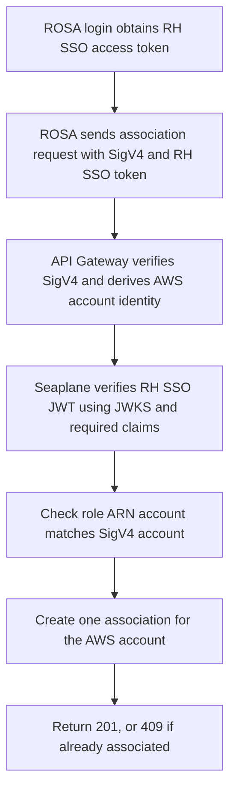

# Cloud discovery role association POC

This POC exposes `POST /api/v0/cloud_discovery/associations`. It creates one
association per AWS account between the account and a customer-supplied IAM
role ARN. It does not yet assume or validate the role with STS.

## Request and identity

The request body contains only the role ARN:

```json
{
  "roleArn": "arn:aws:iam::123456789012:role/SeaplaneCloudDiscovery"
}
```

The route requires two independent credentials:

- API Gateway verifies SigV4 and supplies `X-Amz-Account-Id` and
  `X-Amz-Caller-Arn`.
- The client sends an RH SSO **access token** in
  `X-RH-SSO-Authorization: Bearer <JWT>`. SigV4 remains in the ordinary
  `Authorization` header.

The account ID is derived only from the verified gateway identity; it is not
accepted in the body or URL. The role ARN must be an IAM role in that exact
AWS account. The JWT must have the configured issuer, audience, and `azp`;
`sub`, an organization claim (`org_id`, `organization.id`, or `rh-org-id`),
and `is_org_admin: true` are required. `account_id`, `username`, and
`preferred_username` are stored when present. No Accounts Management lookup is
performed.

The decoded ID-token example with `typ: "ID"` is not accepted. Send the normal
bearer access token used by Clusters Service. For migration continuity, the
POC can be configured for `aud=cloud-services` and `azp=cloud-services`.

## RH SSO configuration

Set the following flags (or corresponding environment variables) to enable the
route:

| Flag | Environment variable | Purpose |
| --- | --- | --- |
| `--rh-sso-jwks-url` | `RH_SSO_JWKS_URL` | HTTPS RH SSO certs/JWKS endpoint |
| `--rh-sso-jwks-file` | `RH_SSO_JWKS_FILE` | Local JWKS file; can be used with the URL |
| `--rh-sso-acl-file` | `RH_SSO_ACL_FILE` | UHC-style claim ACL file; an empty file is allowed |
| `--rh-sso-jwt-issuer` | `RH_SSO_JWT_ISSUER` | Exact token `iss` |
| `--rh-sso-jwt-audience` | `RH_SSO_JWT_AUDIENCE` | Required token `aud` |
| `--rh-sso-jwt-azp` | `RH_SSO_JWT_AZP` | Required token `azp` |

The route is not registered if no RH SSO configuration is supplied. Partial or
invalid configuration fails startup. JWKS errors fail closed, including
refresh failures; a configured local JWKS file is not a stale-key fallback
when the URL is configured. RSA `RS256` and `RS512` signing keys are accepted.
ACL rules follow UHC semantics: a token is ACL-allowed if any configured rule
matches. Issuer, audience, authorized party, and org-admin checks are separate
mandatory checks and cannot be weakened by an empty ACL.

## Storage and limits

The record is stored as an internal typed seaplane-db object in
`account-<aws-account-id>`, with a fixed name. The database primary key makes
creation atomic: the first request succeeds; later creates return `409`.
There is no update or delete route in this POC.

The POC stores the role ARN and RH SSO subject/account/organization attribution.
It does not store JWTs or AWS credentials. Trust-policy validation, an STS
assume-role check, role rotation, and revocation are future work.

## ROSA login and request flow

`rosa login --use-auth-code` uses the OCM CLI OAuth client (`ocm-cli`) with
authorization code + PKCE. The CLI stores the resulting refresh token, then
uses the OCM SDK connection to obtain and persist an access token. The
association operation must send that **access token**, not the ID token from
the browser's OIDC response. Tokens with a `typ: ID` claim are rejected.

The normal `WithSeaplane` client path is currently AWS/SigV4-only. The POC
operation needs a token provider that refreshes/obtains the OCM access token
and adds it as `X-RH-SSO-Authorization` before the SigV4 signer runs. This
preserves `Authorization` for SigV4 and includes the additional header in the
signed request. `rosa login --seaplane-url` by itself does not perform OCM
login, so it is insufficient for this operation.



* Request headers: `Authorization: AWS4-HMAC-SHA256 ...` carries SigV4;
  `X-RH-SSO-Authorization: Bearer <access-token>` carries RH SSO. Add the RH
  SSO header before SigV4 signing so it is covered by `SignedHeaders`. Do not
  send the AWS account ID in the request body.

The current OCM client login uses `aud=cloud-services`; the POC config must
allow that value during migration. The sample `typ: ID` token is not forwarded:
the client must use the access token issued/refreshed for API requests.
