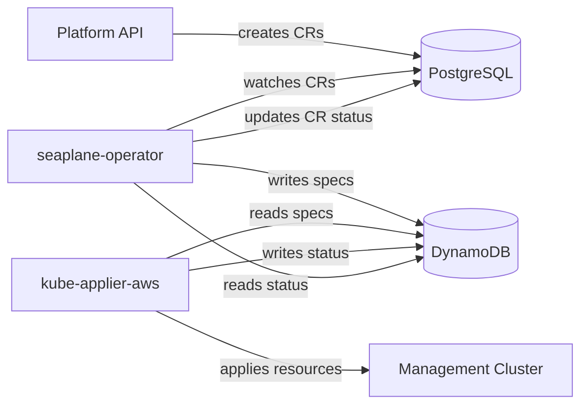

# Seaplane Operator Architecture

## Overview

The seaplane-operator is a cluster lifecycle controller for ROSA HCP. It watches Custom Resources stored in PostgreSQL (via pgruntime) and writes DynamoDB desires that kube-applier-aws applies to management clusters.



## Components

### PostgreSQL (pgruntime)

The operator uses [fleetdb](../../seaplane-db/) to implement the controller-runtime `client.Client`, `cache.Cache`, and `manager.Manager` interfaces backed by PostgreSQL. It is controller-runtime-compatible storage, not a Kubernetes API server: it has no admission or CRD validation, Kubernetes garbage collection, or transactions across resources. Updates and deletes use per-object UID and resource-version checks; informer List/Watch streams are poll-based and sharded, while direct reads see the full dataset. See the [seaplane-db guidelines](../../docs/seaplane-db-guidelines.md) and [compatibility notes](../../seaplane-db/docs/COMPATIBILITY.md) for the storage contract.

### CRDs

CRDs are under API group `seaplane.io/v1alpha1`. Most are **namespace-scoped** — the namespace is `account-<accountID>`, with the account ID also stored in the `seaplane.io/account-id` label. **ManagementCluster** is the exception: it is **cluster-scoped** and declared as an `UnshardedGVK` so every operator pod sees all ManagementClusters regardless of its shard assignment.

- **Cluster** — represents a ROSA HCP cluster. `metadata.Name` is a client-chosen DNS label; `metadata.Namespace` is `account-<accountID>`. Spec contains all the configuration needed to create a HostedCluster on a management cluster.
- **NodePool** — represents a set of worker nodes for a Cluster. Named `<cluster>.<child>` in the same account namespace. Parent ownership and shard affinity use an ownerReference and `seaplane.io/cluster-uid` label.
- **Placement** — binds a Cluster to a management cluster. Created automatically by the Placement controller. In the same account namespace.
- **DNSReservation** — customer-facing resource that reserves a DNS prefix and base domain. It can be created before a Cluster for shared-VPC flows. Claimed by a Cluster via the `seaplane.io/claimed-by-cluster-uid` label.
- **OidcConfig** — represents an OIDC issuer configuration for cluster identity.
- **Index** — internal uniqueness resource used for DNS prefix and OIDC issuer URL reservations.
- **ManagementCluster** — represents a management cluster in the fleet. Stores region and account metadata.
- **Manifest** — deploys arbitrary Kubernetes resources to a management cluster. A generic pass-through: raw manifests are written as-is to DynamoDB ApplyDesires. Resources with `watch: true` also get ReadDesires, mirroring their live state from the MC back into the CR status.

### Controllers

See individual controller docs for detailed creation/deletion flows:

- [Placement Controller](placement-controller.md) — auto-creates Placement for new Clusters
- [Cluster Controller](cluster-controller.md) — generates MC resources, manages lifecycle
- [NodePool Controller](nodepool-controller.md) — generates NodePool resources on MC
- [Manifest Controller](manifest-controller.md) — deploys arbitrary resources to MC

## DynamoDB Desire Pattern

The operator is the **inverse** of kube-applier-aws:

|                         | Specs tables | Status tables |
| ----------------------- | ------------ | ------------- |
| **seaplane-operator** | writes       | reads         |
| **kube-applier-aws**    | reads        | writes        |

Per management cluster, there are 4 DynamoDB tables:

- `{mc}-specs-applydesires` / `{mc}-status-applydesires`
- `{mc}-specs-readdesires` / `{mc}-status-readdesires`

Deletion of a Kubernetes resource is expressed as an `ApplyDesire` with
`spec.type=Delete` — there is no separate `deletedesires` table.

### Document IDs

Document IDs are deterministic UUID v5 values computed from the resource identity:

```
documentID = UUIDv5(NamespaceUUID, "{taskKey}/{group}/{version}/{resource}/{namespace}/{name}")
```

- **NamespaceUUID**: `a3f1b2c4-d5e6-4f7a-8b9c-0d1e2f3a4b5c` (shared with kube-applier-aws)
- **taskKey**: `seaplane-operator` for Cluster/NodePool ApplyDesires, `seaplane-operator-read` for ReadDesires, `seaplane-manifest/{namespace}/{name}` for Manifest (scoped per CR to prevent collisions)

Same inputs always produce the same UUID, giving natural idempotency — re-reconciling a Cluster writes the same document IDs, updating existing rows rather than creating duplicates.

For details on how controllers read, write, and delete specs, see [DynamoDB Read/Write Strategy](dynamodb-strategy.md).

### Management Cluster Registry

ManagementCluster CRs in PostgreSQL serve as the registry of available management clusters. The Placement controller reads this registry to select a management cluster for new Clusters.

## Deployment

The operator runs as a StatefulSet, deployed via a Helm chart through ArgoCD. It connects to PostgreSQL for CR storage and to DynamoDB for desire management. The StatefulSet provides stable pod ordinals used for [Cluster-UID sharding](sharding.md).

```
charts/seaplane-operator/
├── Chart.yaml
├── values.yaml
├── crds/                    # Auto-synced from config/crd/bases/ by make manifests
└── templates/
    ├── statefulset.yaml
    ├── headless-service.yaml
    ├── serviceaccount.yaml
    ├── clusterrole.yaml
    └── clusterrolebinding.yaml
```

Required configuration:

- `awsRegion` — AWS region for DynamoDB
- `baseDomain` — DNS base domain for hosted clusters
- `POSTGRES_DSN` — PostgreSQL connection string

## Horizontal Scaling via Cluster-UID Sharding

The operator partitions cache List/Watch streams using namespace plus `seaplane.io/cluster-uid` when present, or namespace plus the row's own database UID otherwise. The Cluster falls back to its UID; NodePools and Placements carry that UID label and share its shard. Account-level resources without the label shard by their own UIDs within the namespace. ManagementCluster is unsharded. Each StatefulSet replica owns one shard equal to its pod ordinal. See [Sharding](sharding.md) for the exact predicate and scaling limits.
