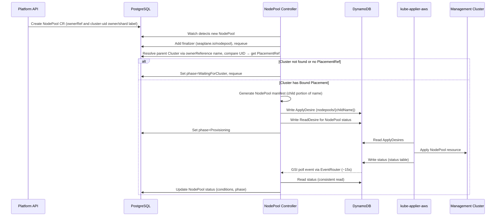
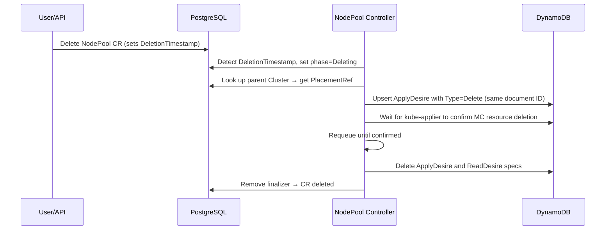

# NodePool Controller

## Creation Flow

### Reconcile Steps

1. **Finalizer**: Adds `seaplane.io/nodepool` finalizer on first reconcile, requeues
2. **Parent Cluster lookup**: Resolves the parent Cluster by the ownerReference name in the same account namespace, then compares UID. Waits if the Cluster is not found or has no `PlacementRef`
3. **Manifest generation**: Extracts the child portion of the `<cluster>.<child>` name and generates a HyperShift NodePool manifest
4. **ApplyDesire**: Writes one ApplyDesire to `{mc}-specs-applydesires`
5. **ReadDesire**: Creates a ReadDesire for the NodePool to get status feedback (extracts "Ready" condition from the remote NodePool)
6. **Status propagation**: Reads status from DynamoDB, updates NodePool CR conditions (Synced, Ready) and phase
7. **Requeue**: Requeues every 5 minutes as a fallback; GSI two-speed polling via EventRouter provides the primary notification path (~15s latency)

### Generated Resource

The NodePool manifest on the MC uses the child portion of the `<cluster>.<child>` name and lives in namespace `cluster-<Cluster UID>`.

| Resource              | Name          | Namespace               | Purpose                                   |
| --------------------- | ------------- | ----------------------- | ----------------------------------------- |
| NodePool (HyperShift) | `{childName}` | `cluster-<Cluster UID>` | Worker node set on the management cluster |

## Deletion Flow

When a NodePool is deleted (either standalone or as part of Cluster cascade deletion):

### Deletion Steps

1. **PlacementRef lookup**: Gets the parent Cluster's PlacementRef to determine the target MC
2. **ApplyDesire Type=Delete**: Upserts the existing ApplyDesire with `Type=Delete` using the same document ID. kube-applier sees a MODIFY event and deletes the NodePool from the MC
3. **Confirmation**: Waits for kube-applier to confirm the MC resource deletion via the status table
4. **DynamoDB cleanup**: Deletes the ApplyDesire and ReadDesire specs from DynamoDB
5. **Finalizer removal**: Removes finalizer, allowing the CR to be garbage-collected

The parent Cluster and Placement are unaffected by standalone NodePool deletion.
